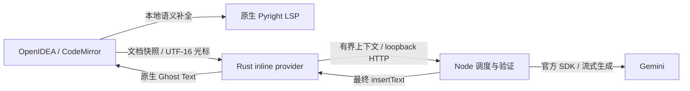

# Python AI 行内补全

AI Assistant 通过 OpenIDEA 原生 Inline Completion Provider 提供单行和多行 Ghost Text。补全默认关闭；启用后，仅发送当前文档中经过字节预算限制的上下文。Gemini 密钥只存在于本机 Node 服务的环境变量中。

启用后，当前文件的绝对路径、光标位置和有界源码上下文会发送给 Gemini；绝对路径可能包含本机用户名和项目名称。

## 架构与接入边界

当前仓库是 Rust/WASI 插件工作区，没有前端编辑器源码。锁定的 OpenIDEA SDK 为 `v0.1.42`；对应宿主使用 React 19、CodeMirror 6、Tauri 和原生 LSP。插件复用宿主的编辑器生命周期、Python 工作区、解释器、普通补全与行内补全，不创建临时 Python 项目，也不引入另一套编辑器。



普通补全仍由本地语言服务负责；AI 失败不会修改文档或阻止本地补全。灰色预测在接受前只存在于原生编辑器的预览状态。

宿主已经实现 Tab 接受全部、Esc 取消、逐词接受、输入/移动光标取消请求，以及文档和选区变化后的结果丢弃。传统补全列表与 Ghost Text 的互斥也沿用宿主行为。

宿主会先等待语言服务器的行内补全，只有其返回空结果或出错时才调用插件 Provider；如果语言服务器已有行内预测，插件不会同时提供另一条预测。普通 LSP 补全列表仍由宿主独立处理。

当前 SDK 的 `InlineSuggestion` 只返回最终文本和可选替换范围，`host::fetch` 也只返回完整响应体。因此服务端会流式消费 Gemini 输出、记录首文本延迟，但编辑器收到的是完整预测。增量 Ghost Text、逐行接受、补全接受率和本地 LSP 延迟的采集需要宿主提供相应接口，此插件没有伪造这些能力。

上游依据：[原生行内补全实现](https://github.com/l0ng-ai/openidea/blob/v0.1.42/src/editor/lsp/inlineCompletion.ts)、[SDK Provider 契约](https://github.com/l0ng-ai/openidea/blob/v0.1.42/sdk/rust/openidea-plugin/src/providers.rs)、[WIT 返回结构](https://github.com/l0ng-ai/openidea/blob/v0.1.42/sdk/rust/openidea-plugin/wit/providers.wit)。

## 构建和安装插件

在仓库根目录运行：

```powershell
rustup target add wasm32-wasip2
./scripts/build.ps1
```

构建产物位于 `plugins/ai-assistant/dist/plugin.wasm`。在 OpenIDEA 的插件设置中选择 **Install Plugin from Disk**，安装整个 `plugins/ai-assistant` 目录，授予清单声明的本机网络权限。原有翻译、命名和提交信息功能使用自己的 OpenAI-compatible 服务，与本节的 Gemini 服务独立。

## 配置 Gemini 并启动本机服务

需要 Node.js 22 或更新版本。在本机终端运行：

```powershell
Set-Location D:\tmp\ai-commit-rust\plugins\ai-assistant\server
npm ci
Copy-Item .env.example .env
# 在本机编辑 .env：AI_ENABLED=true，并填写 GEMINI_API_KEY。
node --env-file=.env index.js
```

`.env` 已被 Git 忽略。不要把密钥放入插件设置、源码或补全请求。默认监听 `127.0.0.1:8765`，模型 `gemini-3.8-flash`，思考等级 `LOW`，温度 `0.15`，候选数 `1`，最多输出 `256` tokens。使用 Google 官方 `@google/genai`，默认流式生成，不自动重试。

在 OpenIDEA 的 **Settings → Plugins → AI Assistant → AI Completion** 打开 `completionEnabled`。同时开启编辑器原生行内补全。插件设置包括：

| 设置 | 默认值 | 用途 |
| --- | --- | --- |
| `completionEnabled` | `false` | 用户明确启用后才发送源代码 |
| `completionPort` | `8765` | 匹配服务端 `AI_COMPLETION_PORT`，目标固定为 loopback |
| `completionContextBytes` | `24000` | prefix、suffix、源码提示合计 UTF-8 字节上限 |
| `completionRequestTimeoutMs` | `12000` | 包括服务端防抖和模型生成的总请求时限 |

服务端的模型、温度、思考等级、输出长度、上下文、缓存、防抖、超时与流式开关见 [服务说明](server/README.md) 和 [.env.example](server/.env.example)。插件上下文上限应不大于服务端上限；插件时限应大于服务端防抖与超时之和。编辑器的自动/手动触发设置由宿主控制，因为 Provider 不接收触发原因。

原生防抖与服务端防抖会累加；在宿主已经设置 300 ms 停顿触发时，可以将 `AI_COMPLETION_DEBOUNCE=0`。服务端默认 300 ms，适合未配置宿主停顿的情况。

`GET /health` 检查服务是否启用，`GET /metrics` 提供不含代码、文件路径和凭据的聚合计数。服务端拒绝带浏览器 Origin 的请求，不启用 CORS，不提供公网监听。它没有本机用户认证，适合个人开发机；能访问本机进程的其他程序也能调用该端口，应限制 Gemini 密钥配额。

## 复用原生 Pyright

1. 在 OpenIDEA 打开真实 Python 项目目录。
2. 在 **Settings → Languages & Frameworks → Language Servers** 中为 Python 选择 `pyright`，通过宿主的安装入口安装语言服务器。
3. 在项目的 Python Interpreter 设置中选择真实解释器，优先选择项目 `.venv`。宿主会把解释器和虚拟环境传递给语言服务。
4. 在该环境中安装项目实际依赖；例如 pandas 的类型提示需要解释器能访问 pandas 及相应类型信息。不要把项目复制为单个临时文件交给 LSP。

示例：使用已存在的项目虚拟环境安装项目所需依赖：

```powershell
.\.venv\Scripts\python.exe -m pip install pandas pandas-stubs
```

Pyright 的项目模块搜索路径、类型检查模式和依赖配置继续使用项目自己的 `pyrightconfig.json` / `pyproject.toml`。有关解释器和可选 Python 语言服务器，见 [OpenIDEA Python 文档](https://github.com/l0ng-ai/openidea/blob/v0.1.42/docs/en/languages/python.mdx)。

## 模块职责和隐私

| 文件 | 职责 |
| --- | --- |
| `../../crates/ai-code-helper/src/completion.rs` | 原生 Provider、光标定位、字节预算、源码提示、loopback 请求及最终预测 |
| `src/lib.rs`、`plugin.toml` | 统一入口转发 Python inline-completion，保留既有命令 |
| `settings/completion.json` | 插件启用开关、端口、预算和时限 |
| `server/config.js` | 在监听前校验环境配置 |
| `server/completion.js` | 插入位置 Prompt 和补全结果过滤 |
| `server/server.js` | 防抖、取消、缓存、并发限制、SDK 请求及聚合指标 |
| `server/index.js` | 读取环境、创建官方 SDK 并监听 loopback |
| `server/server.test.js`、`server/benchmark.js` | 自动化验证和可重复的本机模拟基准 |

源码提示使用当前文档中的 import、函数/类签名、外围作用域、显式注解，以及当前行引用的变量定义；这是有界的文本启发式提取，不声称提供 Pyright 的推断类型或诊断。Provider 没有语义查询接口，因此 AI 请求没有跨文件类型检索和实时诊断。它不遍历项目磁盘，也不上传整个项目。

Prompt 的工程约束独立编写，要求遵循已有符号、接口和风格，只生成光标处必要的代码，并把源码视为数据。结果过滤不替代 Python AST 或语言服务；不完整文件中的局部补全仍允许返回，最终语义与语法诊断由原生 LSP 提供。

## 验证和验收

```powershell
cargo fmt --all -- --check
cargo clippy --workspace --all-targets -- -D warnings
cargo test --workspace
cargo build --workspace --target wasm32-wasip2 --release
Set-Location plugins/ai-assistant/server
npm test
npm run benchmark
```

Rust 测试覆盖选择启用、请求字段、UTF-16/emoji、多行文本、上下文字节上限、保留当前作用域、无编辑副作用、取消/失败和非法响应。Node 测试覆盖协议边界、流式消费、缓存、请求竞争、断开/超时/限流及输出验证。模拟基准测量本机 HTTP 和受控模拟 SDK；数值不能当作 Gemini 延迟或编辑器性能。

以下验收需要运行 OpenIDEA 和真实项目，不能用 Mock 测试代替：

- AI 关闭时：验证变量、函数、类方法、import、参数提示、返回类型推断以及 `pandas.DataFrame` 属性补全。
- AI 开启时：验证注释生成、多行函数体、中间插入、缩进、Tab、Esc 和逐词接受；预览期间文档应保持不变。
- 连续输入与快速切换文件/光标：旧预测不得覆盖新版本；关闭编辑器后请求应结束。
- 停止 Gemini 服务或语言服务：编辑器仍可编辑；AI 不可用时本地 Pyright 补全继续工作。

真实 Gemini 的首文本延迟、质量和 token 消耗需要有效密钥与实际工作负载测量。当前交付不把模拟结果或上游代码阅读当作这些验收已经通过。
